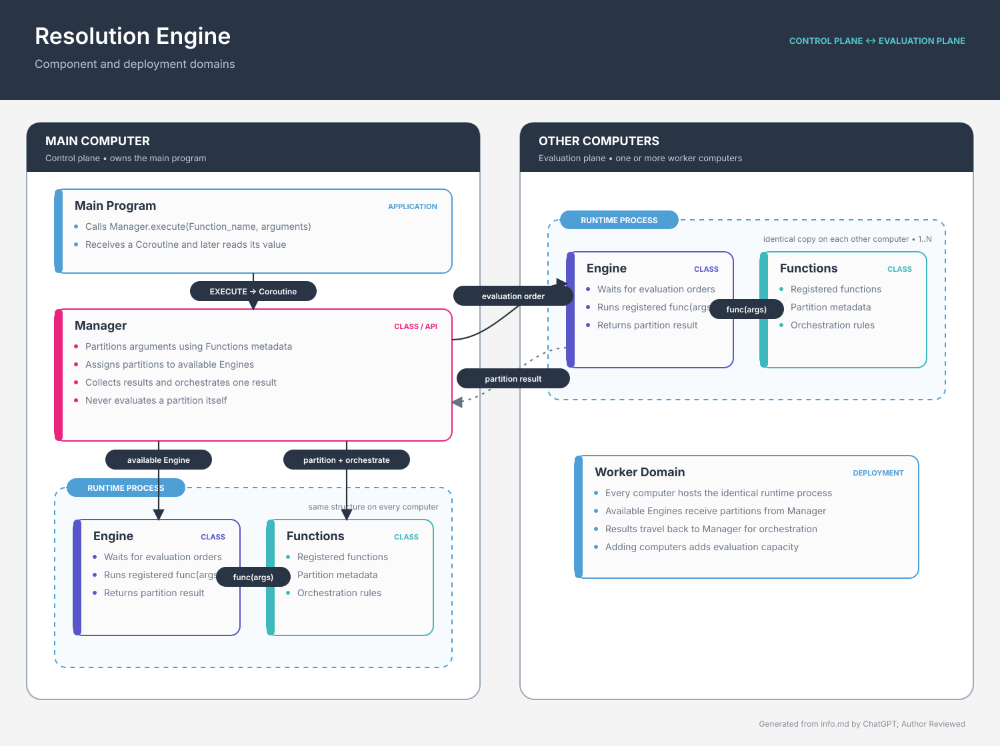
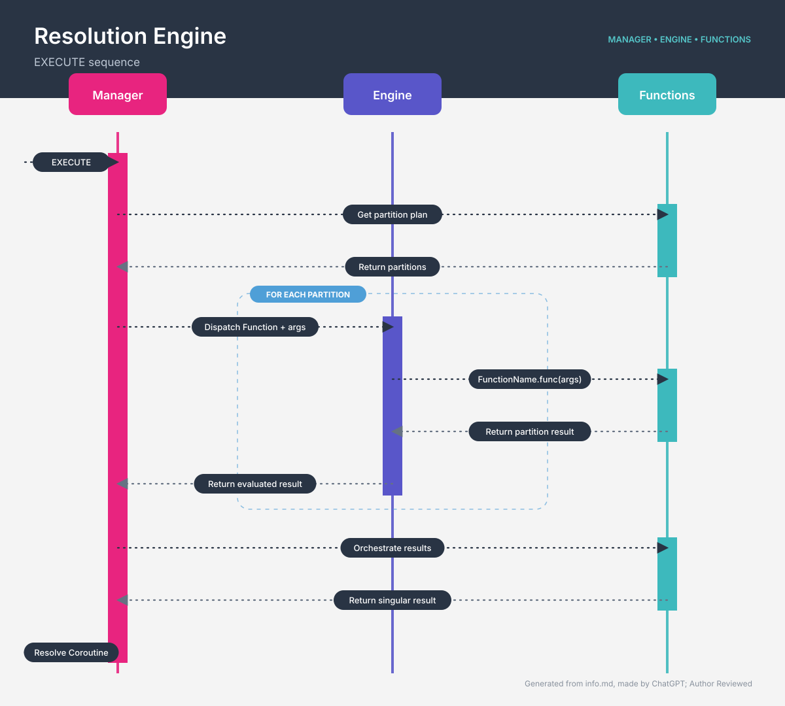
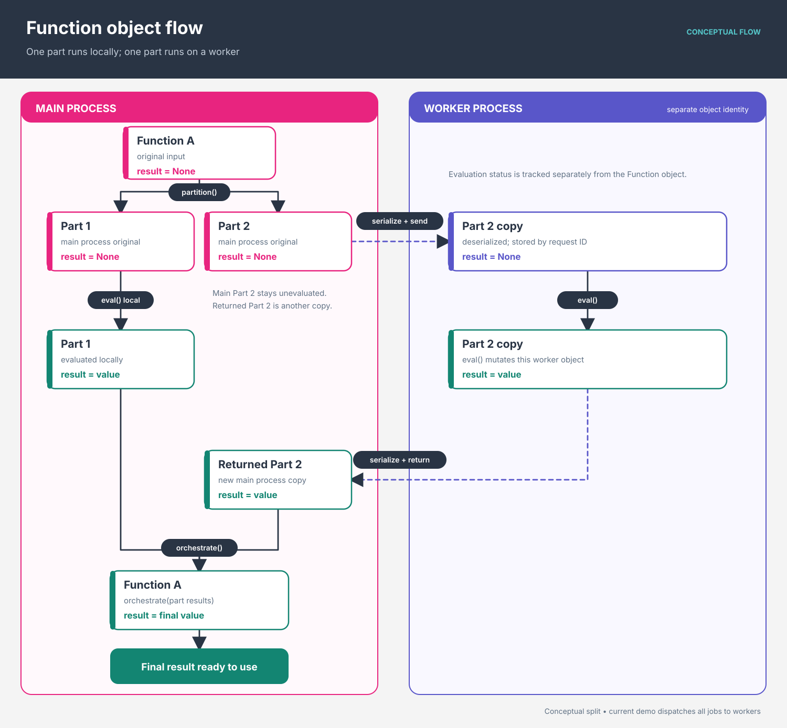
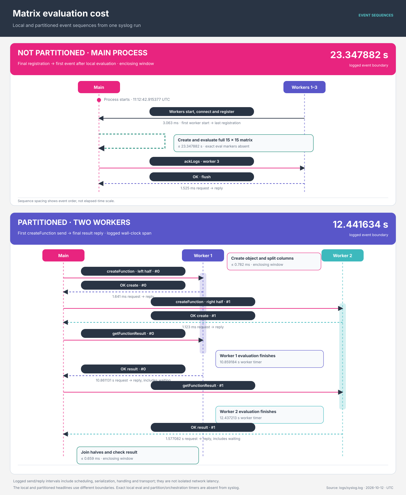

# mpi.c

`mpi.c` is an experimental Python project for splitting a function into smaller
functions, evaluating them in separate processes, and combining their results.
Despite its name, it is not an MPI implementation. The current runnable demo
uses local TCP connections between one main process and three worker processes.

## Run the demo

You need Python 3.10 or newer, Bash, and permission to open localhost TCP
sockets. The demo uses only the Python standard library.

From the repository root, run:

```bash
bash scripts/run.sh
```

The launcher starts `src/main_process.py` and workers 1, 2, and 3 from `src/`.
The main process listens on `127.0.0.1:5001`; workers connect and register.
Workers 1 and 2 evaluate the two partitions. Worker 3 stays connected but does
not evaluate a partition in this demo.

The program prints the matrix size, local and distributed elapsed times, their
ratio, whether the results match, and the path of the run's syslog file. A
successful run writes one file under `logs/`, named
`syslog-<UTC timestamp>-<unique suffix>.log`.

The matrix calculation deliberately sleeps for 0.1 seconds per output entry,
so a run takes tens of seconds. The timings illustrate process overlap and
protocol overhead, not a useful measure of matrix multiplication speed.

## How the demo works

1. The main process starts a TCP server and waits for the three workers to
   register. The launcher starts the workers as separate Python processes.
2. The main process creates two 15 × 15 matrices. It evaluates the complete
   `MatrixMultiplication` locally as a comparison result.
3. It creates another function object and splits the right-hand matrix by
   columns into two function objects.
4. It sends one serialized partition to each of workers 1 and 2 using a
   `createFunction` request. Each worker stores its own deserialized copy,
   acknowledges creation, and then evaluates that copy. The acknowledgment
   lets the main process assign worker 2 while worker 1 is evaluating.
5. The main process requests each completed function with
   `getFunctionResult`, combines the two result matrices in column order, and
   checks the result against the local calculation.
6. It collects and acknowledges worker log batches, merges them with its own
   logs, and writes the timestamped syslog file.

Each network request has a corresponding reply. The main process waits for each
reply before sending its next request; computation can overlap across the two
workers because evaluation starts after each creation acknowledgment. Messages
are newline-delimited JSON, and function objects cross the process boundary as
serialized state. Evaluation changes a worker's copy; the main process receives
another deserialized copy when it requests the result.

## Code map

| Path                                                                   | Role                                                                                               |
| ---------------------------------------------------------------------- | -------------------------------------------------------------------------------------------------- |
| [`scripts/run.sh`](scripts/run.sh)                                    | Starts the main process and three workers, then waits for them.                                    |
| [`src/main_process.py`](src/main_process.py)                          | Runs the comparison, assigns partitions, combines results, and writes the syslog.                  |
| [`src/other_process.py`](src/other_process.py)                        | Registers a worker, dispatches requests, evaluates stored functions, and returns results and logs. |
| [`src/network.py`](src/network.py)                                    | Opens localhost sockets, registers workers, and sends requests and replies.                        |
| [`src/message.py`](src/message.py)                                    | Serializes messages, primitive values, and registered objects to JSON.                             |
| [`src/functions.py`](src/functions.py)                                | Defines the`Function` contract and a `Sum` implementation.                                     |
| [`src/matrix.py`](src/matrix.py)                                      | Implements the matrix function used by the demo.                                                   |
| [`src/registered_types.py`](src/registered_types.py)                  | Lists function and log types allowed in messages.                                                  |
| [`src/log.py`](src/log.py), [`src/log_buffer.py`](src/log_buffer.py) | Represent events, retain log batches until acknowledged, and format syslog output.                 |

A `Function` implementation supplies `partition()`, `eval()`, `orchestrate()`,
`serialize()`, and `deserialize()`. `eval()` stores its output in `result` and
returns whether it succeeded. The current matrix implementation always creates
two partitions. `Sum` is registered and illustrates the same contract, but the
launcher does not run it. To use another function in the demo, implement and
register it in `src/registered_types.py`, then update the fixed workload in
`src/main_process.py`.

## Logs

To regenerate the matrix event-sequence diagram from the newest timestamped
syslog file, run:

```bash
python3 tools/generate_cost_event_sequences.py
```

Pass `--log logs/NAME.log` to select a particular run. The generator falls back
to the legacy `logs/syslog.log` if no timestamped run exists. See
[`tools/cost_event_sequences.md`](tools/cost_event_sequences.md) for how the
diagram's timings are interpreted.

## Diagrams

The first three diagrams explain the intended resolution-engine design and how
function objects move between processes. They are conceptual: the runnable demo
uses fixed local workers and does not implement the full Manager/Engine API. The
last diagram shows events measured from one matrix-demo run.

### Components and deployment



The component diagram shows the proposed roles of the main program, Manager,
Engines, and Functions, and how work and results would cross computer boundaries.

### Execution sequence



The sequence diagram follows a proposed `EXECUTE` call: plan partitions, send
each one to an Engine, evaluate it, and combine the returned results.

### Function object flow



The object-flow diagram tracks which copy of a function is changed by `eval()`
and which copy returns for orchestration. It illustrates one local and one
worker-evaluated partition; the current matrix demo evaluates both partitions
in workers.

### Matrix evaluation events



This diagram shows logged request, reply, and worker-evaluation events from one
run. Its local and partitioned headline durations use different event
boundaries, so they are not a direct speedup comparison.

## Testing and current limitations

`bash scripts/run.sh` is the end-to-end check for the current demo: it compares
the local and partitioned results and raises an error if they differ. The files
under `tests/test_python_only/` still reference removed modules or earlier
prototypes; they are not a maintained test suite for the current demo.

The demo uses a fixed localhost address and port, three fixed worker IDs, and
a two-way matrix partition. It has no remote-host support, automatic placement,
retries, recovery, or authentication. Requests are synchronous, and worker
state lives only for the process lifetime. The syslog file is written after a
successful comparison and log collection, so a failed run may produce no file.

The earlier task prototype is now under [`task_prototype/`](task_prototype/),
while historical implementations are under [`deprecated/`](deprecated/).

## License

This project is available under the [MIT License](LICENSE).
